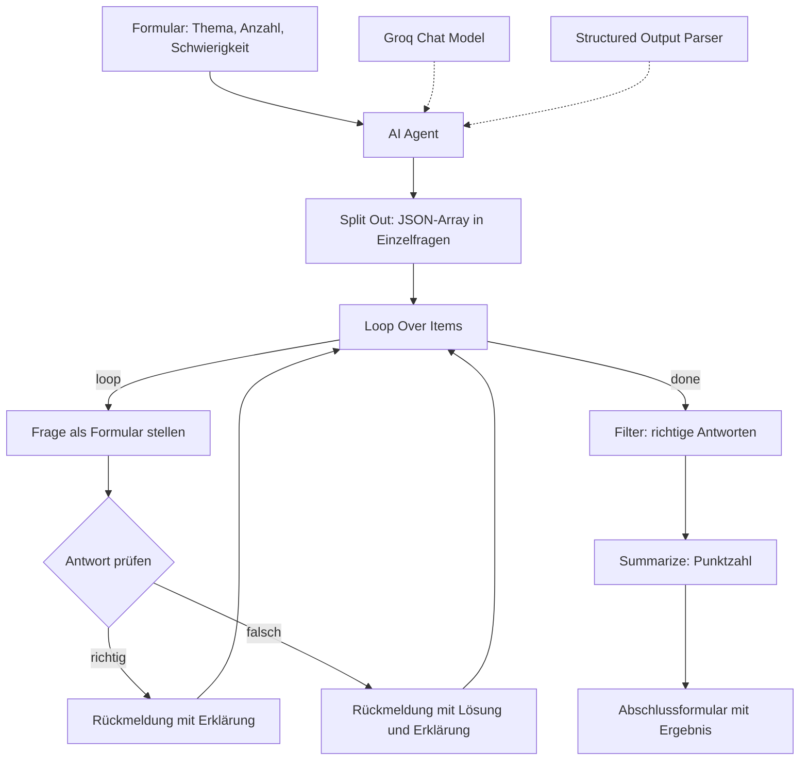

# Multiple-Choice-Lerngenerator

Ein n8n-Workflow, der zu einem frei gewählten Thema Multiple-Choice-Fragen erzeugt und sie direkt im Browser abfragt. Entstanden im Rahmen der Weiterbildung zum KI-Integrationsmanager (IHK).

## Projektziel

Wer sich auf eine Prüfung vorbereitet, hat das Lernmaterial meistens als Fließtext vorliegen. Zum Üben braucht man aber Fragen, und die muss sich bisher jeder selbst schreiben. Das kostet Zeit und man stellt sich unweigerlich genau die Fragen, deren Antwort man schon kennt.

Der Workflow dreht das um. Man gibt ein Thema, eine Anzahl und einen Schwierigkeitsgrad an, ein Sprachmodell erzeugt daraus die Fragen samt Lösung und Erklärung, und der Workflow stellt sie nacheinander als Formular. Jede Antwort wird sofort ausgewertet, falsche Antworten werden erklärt, am Ende steht die Punktzahl.

Der eigentliche Punkt dabei ist nicht der Lerneffekt, sondern die Technik dahinter: Es ist ein vollständiger Durchlauf von Nutzereingabe über einen strukturierten KI-Aufruf bis zur Auswertung, ohne eine Zeile Anwendungscode.

## Verwendete Tools

| Baustein | Eingesetzt wofür |
|---|---|
| n8n (lokal in Docker) | Ablaufsteuerung, alle Knoten |
| Formular-Trigger | Eingabe von Thema, Anzahl und Schwierigkeit |
| AI Agent (LangChain-Knoten) | Erzeugen der Fragen |
| Groq Chat Model | Modellanbieter, Modell `openai/gpt-oss-safeguard-20b` |
| Structured Output Parser | erzwingt die Antwort im vorgegebenen JSON-Schema |
| Split Out | zerlegt die Modellantwort in einzelne Fragen |
| Loop Over Items | arbeitet die Fragen nacheinander ab |
| Formular-Knoten | stellen die Frage und geben die Rückmeldung aus |
| IF und Filter | Antwortprüfung und Zählung der richtigen Antworten |
| Summarize | Punktzahl für das Abschlussformular |

Bewusst nicht verwendet: Datenbank, Mailversand, externe Ablage. Der Workflow ist in sich geschlossen und läuft vollständig lokal, nur der Modellaufruf geht nach außen.

## Workflow

**1. Daten empfangen.** Der Formular-Trigger zeigt ein Webformular mit drei Feldern: Anzahl der Fragen als Zahl mit Vorgabewert 5, Thema als Freitext und Schwierigkeit als Auswahl zwischen leicht, mittel und schwer.

**2. KI-Auswertung.** Der AI Agent setzt die drei Eingaben in einen Prompt ein und fordert die Fragen als JSON-Array an. Das Format ist an zwei Stellen festgelegt: als Beispiel im Prompt und noch einmal im Structured Output Parser. Jeder Datensatz enthält die Frage, vier Antwortoptionen A bis D, den Buchstaben der richtigen Antwort und eine Erklärung.

**3. Verarbeitung.** Split Out zerlegt das Array in einzelne Items, damit der Workflow jede Frage für sich behandeln kann. Loop Over Items arbeitet sie dann nacheinander ab.

**4. Abfrage und Prüfung.** Je Durchlauf baut ein Formular-Knoten die Frage als Checkbox-Liste aus den vier Optionen. Die Antwort des Nutzers kommt als Text zurück, das Modell hat aber nur den Buchstaben der Lösung geliefert. Der IF-Knoten löst das auf, indem er über `optionen[richtige_antwort]` den zugehörigen Text nachschlägt und beide vergleicht. Je nach Ergebnis erscheint eine der beiden Rückmeldungen, danach springt der Ablauf zurück in die Schleife.

**5. Ergebnis.** Ist die Schleife durch, zählt der Filter die richtigen Antworten, Summarize bildet die Summe, und das Abschlussformular meldet, wie viele von wie vielen Fragen richtig beantwortet wurden.

## Screenshots

<!-- Screenshot des Workflows in n8n hier einfügen: Bild per Drag and Drop in den GitHub-Editor ziehen, GitHub erzeugt den Link automatisch. -->

*Platzhalter: Gesamtansicht des Workflows in n8n*

*Platzhalter: Eingabeformular*

*Platzhalter: eine gestellte Frage mit Rückmeldung*

## Herausforderungen

**Das Modell antwortete zunächst mit freiem Text.** Ein Sprachmodell hält sich an ein Ausgabeformat nicht allein deshalb, weil man es im Prompt beschreibt. Gelöst wurde das durch zwei gleichzeitige Festlegungen: ein vollständiges Beispielschema im Prompt mit der ausdrücklichen Anweisung, ausschließlich JSON zurückzugeben, und zusätzlich der Structured Output Parser, der dasselbe Schema noch einmal erzwingt und bei Abweichung einen neuen Versuch auslöst.

**Eine Modellantwort, viele Einzelschritte.** Das Modell liefert alle Fragen in einem einzigen Item. Für die Abfrage braucht man sie aber einzeln. Die Kombination aus Split Out und Loop Over Items war die Lösung, und damit auch die Erkenntnis, dass die beiden Knoten in n8n fast immer zusammen auftreten.

**Rücksprung in die Schleife.** Die beiden Rückmeldungsformulare führen nicht weiter, sondern zurück auf Loop Over Items. Das war der Punkt, an dem aus einer Kette ein Kreislauf wurde, und es ist die Stelle, die den Workflow von einer reinen Abfolge unterscheidet.

**Buchstabe gegen Text.** Das Formular gibt zurück, was der Nutzer angeklickt hat, also den Antworttext. Das Modell liefert die Lösung als Buchstabe. Der Vergleich funktioniert erst, wenn man den Buchstaben als Schlüssel in das Optionen-Objekt einsetzt.

### Offene Punkte

Zwei Stellen funktionieren in der hochgeladenen Fassung noch nicht und sind bewusst dokumentiert statt verschwiegen:

Das Abschlussformular greift über `$('Grundlegende Infos einholen')` auf den Formular-Trigger zu. Dieser Knoten heißt inzwischen `On form submission`, der Ausdruck läuft deshalb ins Leere. Ursache ist eine Umbenennung, von der n8n die Ausdrücke in anderen Knoten nicht mitzieht.

Der Filter vor der Auswertung prüft, ob das Antwortfeld den Text `Super` enthält. Diese Bedingung stammt aus einem früheren Entwurf und passt nicht mehr zu den Feldern, die aus den Rückmeldungsformularen zurückkommen. Die Zählung der richtigen Antworten liefert dadurch kein brauchbares Ergebnis.

## Lernerfahrungen

**Ein Knotenname ist eine Schnittstelle.** Der Zugriff auf frühere Knoten über `$('Knotenname')` ist an den Namen gebunden. Benennt man einen Knoten um, bleiben alle Ausdrücke, die auf ihn zeigen, unverändert stehen und brechen still. Das war der lehrreichste Fehler im ganzen Projekt, weil er nicht beim Bauen auffällt, sondern erst beim Ausführen.

**Strukturierte Ausgabe ist eine Konstruktionsentscheidung, keine Prompt-Formulierung.** Solange die Ausgabe eines Modells weiterverarbeitet werden soll, muss das Format erzwungen und nicht erbeten werden. Der Structured Output Parser ist dafür das richtige Werkzeug.

**Formulare in n8n sind nicht nur der Eingang.** Ein Formular-Knoten kann mitten im Ablauf stehen, den Workflow anhalten und auf eine Eingabe warten. Damit lässt sich ein Dialog bauen, ohne eine eigene Anwendung zu schreiben. Dasselbe Muster trägt später jede Freigabe durch einen Menschen.

**Checkbox-Felder liefern ein Array.** Auch bei einer einzigen Auswahl kommt eine Liste zurück, weshalb im Vergleich `antwort[0]` steht. Kleinigkeiten dieser Art kosten beim Bauen mehr Zeit als die eigentliche Logik.

**Ein Prototyp darf Lücken haben, aber sie müssen benannt sein.** Die beiden offenen Punkte oben sind das ehrlichere Ergebnis als ein Repository, das Vollständigkeit behauptet.
